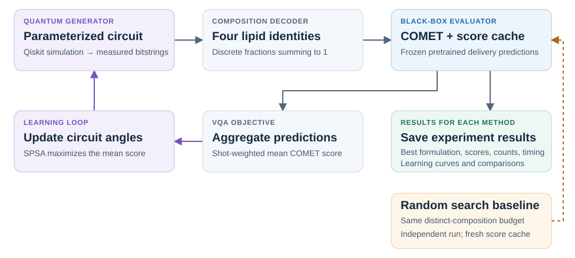

# LipoQ

**Black-box variational quantum search for lipid nanoparticle compositions.**

LipoQ is a research codebase for quantum-assisted lipid nanoparticle design. A shallow parameterized circuit generates LNP formulations, a frozen pretrained [COMET](https://github.com/alvinchangw/COMET) model scores them, and first-order SPSA updates the circuit to increase the mean predicted score. A separate random-search baseline evaluates the same number of distinct formulations.

Only the circuit parameters are trained. COMET predictions are ranking scores—not measured delivery efficacy, probabilities, or efficacy percentages. The experiments use a local simulator and do not establish quantum advantage.

## Workflow



Each formulation contains one ionizable lipid, one phospholipid, one sterol, and one PEG lipid. Fractions are decoded from a feasible integer grid and sum exactly to one. Duplicate formulations share cached predictions; the best candidate is retained across all evaluations, including SPSA perturbations.

There is no surrogate objective, QUBO, QAOA, or second-order approximation. Every new composition is scored directly by the original pretrained COMET model.

## Installation

Tested on macOS arm64 with Python 3.12, PyTorch CPU float32, and Qiskit's local statevector simulator. The reference machine is a MacBook Pro M3 Pro with 18 GB RAM.

Install [uv](https://docs.astral.sh/uv/) and Git, then run:

```bash
git clone https://github.com/Sunghak222/lipoq.git
cd lipoq

uv venv --python 3.12 .venv
uv pip sync --python .venv/bin/python requirements.lock
uv pip install --python .venv/bin/python --no-deps --no-build-isolation -e .
.venv/bin/python scripts/setup_comet.py
```

The lockfile includes plotting and test dependencies. Setup downloads the pinned upstream COMET source and the official lipid-only fold-0 checkpoint, verifies its SHA256, and preserves the upstream license. Assets remain local under `vendor/` and `artifacts/`. Initial setup requires internet access; experiments then run locally.

For an existing checkout after a source-layout update, reinstall the editable package with the `uv pip install ... -e .` command above to refresh CLI entry points.

## Run an experiment

Run commands from the repository root.

### 1. Check pretrained inference

```bash
.venv/bin/lipoq probe --config configs/vqa.yaml
```

This verifies real inference and compares the adapter with COMET's original input pipeline. Every VQA and random-search run performs this check as well. Missing assets, unsupported inputs, model mismatches, or failed inference stop execution; synthetic scores are never substituted.

### 2. Train the VQA

```bash
.venv/bin/lipoq run --config configs/vqa.yaml --seed 21
```

Change `--seed` to `22` or `23` for independent runs. Edit the configuration to change the search space, cell/process conditions, circuit, shots, or optimizer. `--dry-run` validates settings and prints the experiment size without loading COMET or running an experiment.

Each run writes to `results/lnp_search/vqa/seed-<seed>/run-<timestamp>-<id>/`. On completion, learning and discovery curves are exported automatically as PNG and SVG in that run's `plots/` directory.

### 3. Run the matched random baseline

```bash
.venv/bin/lipoq-random --reference-run results/lnp_search/vqa/seed-21
```

The reference may be an exact completed VQA run or its seed directory. A seed directory selects the latest completed run by timestamp, never by score. Random search inherits its COMET model, cell/process conditions, lipid candidates, fraction grid, and distinct-composition budget. It samples uniformly without replacement over compositions, independently of bitstring aliases, and defaults to the same seed.

Random results are written to `results/lnp_search/random/seed-<seed>/run-<timestamp>-<id>/`. `metrics/comparison.csv` and `.json` summarize the matched pair; `plots/comparison.png` and `.svg` are generated automatically. VQA is not rerun. Use `--seed`, `--output`, or `--dry-run` to override the random seed, output root, or inspect the plan.

**Timing policy:** random starts with a fresh in-memory score cache. VQA may reuse its persistent cache. Reports retain actual inference counts and timings but mark elapsed times as not directly comparable under these conditions. The matched budget is the number of distinct compositions encountered, including cached VQA candidates; preflight evaluations are recorded separately.

### 4. Plot saved runs

```bash
.venv/bin/lipoq-plot results/lnp_search
```

This reads existing records only and creates combined figures across seeds. It uses the latest run per seed, rejects incompatible settings, preserves actual stopping lengths, and labels unfinished runs as snapshots. Add `--complete-only`, `--window 5`, or `--output <directory>` as needed.

Module alternatives are `python -m vqa` and `python -m random_search`. The standalone plotting wrapper remains available as `scripts/plot_training.py`.

## Default experiment

[`configs/vqa.yaml`](configs/vqa.yaml) defines the LNP composition search experiment.

| Setting | Value |
|---|---|
| Cell | DC2.4; COMET target `in_house_lnp_DC24_luc` |
| Ionizable lipid IDs | 0, 4, 5, 6, 7, 8, 9 |
| Phospholipid IDs | 1, 13 |
| Sterol IDs | 2, 10, 12 |
| PEG lipid IDs | 3, 11 |
| Search space | 84 lipid combinations × 72 feasible fraction tuples = 6,048 compositions |
| Circuit | 14 qubits; RY → linear CX chain → RY; 28 parameters |
| Sampling | 128 shots per objective call |
| Optimization | First-order SPSA; two perturbation directions per update; at most 200 updates |
| Stabilization | Uniform bitstring initialization, paired sampling, bounded update norm, final five-vector parameter average |
| Early stopping | Minimum 20 updates; five-update windows; patience 3; minimum improvement 0.02 plus a sampling-error margin |
| Fixed process conditions | N/P = 5.287338420806728; aqueous:organic mixing ratio = 1:1 |

| Component | Configured molar-fraction range | Grid step |
|---|---:|---:|
| Ionizable lipid | 0.30–0.55 | 0.05 |
| Phospholipid | 0.10–0.25 | 0.05 |
| Sterol | 0.15–0.59 | 0.01 |
| PEG lipid | 0.01–0.03 | 0.01 |

The sum constraint makes the feasible sterol minimum 0.17. Ratios remain discrete during a run; SPSA learns the probability distribution over the encoded formulations. Non-power-of-two fields use modulo decoding, so uniform bitstrings are not uniform over unique compositions. The random baseline is uniform over compositions.

## Results and interpretation

| Output | Purpose |
|---|---|
| `summary.json`, `best.json` | Run status, best formulation, counts, timings, and termination reason |
| `metadata/config.json`, `metadata/encoding.json` | Resolved settings, fraction grid, and bit allocation |
| `candidates.jsonl` | Compact identity, fractions, score, and cache status for each distinct composition |
| `metrics/history.csv`, `metrics/evaluations.jsonl` | VQA monitoring and every objective call |
| `metrics/early_stopping.jsonl` | VQA plateau checks |
| `metrics/progress.csv`, `metrics/comparison.*` | Random progress and the matched comparison |
| `metadata/model.json`, `preflight.json`, `catalog.json`, `domain.json` | Model provenance, input parity, molecular inputs, and domain checks |
| `plots/`, `plots/plot_status.json`, `metrics/analysis_status.json` | Figures, plotting metadata, and separate export timing/status |
| `summary.json`, `logs/traceback.txt` | Failure or interruption status, partial best/counts, and traceback |

VQA saves initial/final parameters, optimizer state, and measured circuit QASM under `state/`. Source/configuration/model provenance lives under `metadata/`; model logs live under `logs/`. Partial results remain available after interruption; automatic optimizer resume is not implemented. Plotting or comparison-report failures are reported separately from completed searches. Experiment timing ends before postprocessing.

New archives use schema version 2. Existing flat archives remain readable and are not moved or rewritten. Molecular names and SMILES appear once in `metadata/catalog.json`; `best.json` remains fully expanded. The current/partial status is always in `summary.json`, so a failed run cannot also look completed.

The learning figure separates the shot-weighted mean score from the best score found. Thin lines are sampled means; thick lines are trailing averages; shaded bands show ±1 sampling standard error. These are not exact circuit expectations or COMET model uncertainty. The final diamond uses a fresh measurement of the returned, averaged parameters and can differ from the last monitored point. A high best score alone does not demonstrate improvement in the generated distribution.

The retained local seed 21 pair used 4,682 distinct compositions per method. Both found a best COMET score of **8.464256**. VQA's sampled mean changed from **−3.060046** to **5.158117**, stopping after 105 updates. This is one descriptive pair, not a statistical comparison. Raw experiments are local and excluded from Git.

## Code organization

```text
src/
  common/         Shared experiment lifecycle, archive readers, frozen COMET,
                  composition encoding, evaluator/cache, and result utilities
  vqa/            Search adapter, circuit, SPSA, early stopping, audit, and plots
  random_search/  Search adapter, uniform sampler, matched-budget CLI, and reports
configs/
  vqa.yaml        LNP composition search settings
scripts/
  setup_comet.py  Pinned source/checkpoint setup
  verify_run.py   Audit saved VQA results without inference
  plot_training.py  Plot saved learning curves
tests/           Common, VQA, and random-search unit tests
```

`common` does not depend on either search implementation. Random search does not import Qiskit or the VQA optimizer. Both methods use `common.experiment.run_experiment` for model setup, preflight, cache lifetime, timing, completion/failure records, and postprocessing. New methods implement a `SearchContext -> dict` function; they do not copy CLI lifecycle code. See [architecture and extension guide](docs/architecture.md). Generated experiments, downloaded model assets, and presentation files are excluded from source control.

## Validation

```bash
.venv/bin/python -m pytest -q
.venv/bin/python scripts/verify_run.py results/lnp_search/vqa/seed-21/<run-directory>
```

Tests cover valid compositions, endian conventions, finite-shot sampling, weighted objectives, cache deduplication, SPSA accounting, early stopping, matched random budgets, model compatibility checks, and output generation. Small test-only objectives do not exist as selectable experiment backends.

## Scope and provenance

COMET assets are pinned to upstream commit `eee99d2055bad3b7d253c436b3eb7603550b37c5`. The supported checkpoint SHA256 is `8de532194feead3662a33d62855801ebe55b02014eb05e3eedbeb27ee60f7335`. Inference uses the original CPU fallback, frozen float32 weights, one fold, and one deterministic original conformer per molecule. PEG lipids retain the upstream shortened representations. Arbitrary new SMILES are not supported.

Known molecules and fractions within observed marginal bounds do not establish that every joint composition is within COMET's validated domain. Early stopping is a plateau heuristic, not a convergence certificate. Best-found scores are not proven global optima. See the [experimental protocol](docs/protocol.md) for objective, accounting, and model-scope details.

## References

- [COMET source and pretrained assets](https://github.com/alvinchangw/COMET)
- [Designing lipid nanoparticles using a transformer-based neural network](https://www.nature.com/articles/s41565-025-01975-4)
- [Variational quantum algorithm for unconstrained black box binary optimization](https://quantum-journal.org/papers/q-2023-01-26-909/)

LipoQ implements a circuit-distribution search inspired by black-box variational optimization; it is not a reproduction of the reference paper's complete QITE/VarQFS algorithm.
